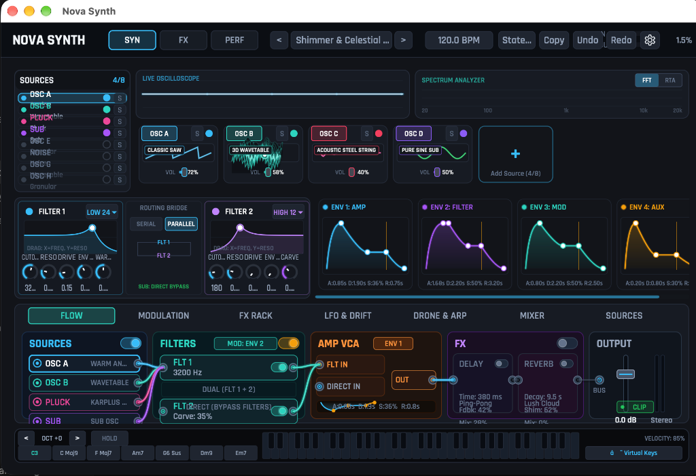
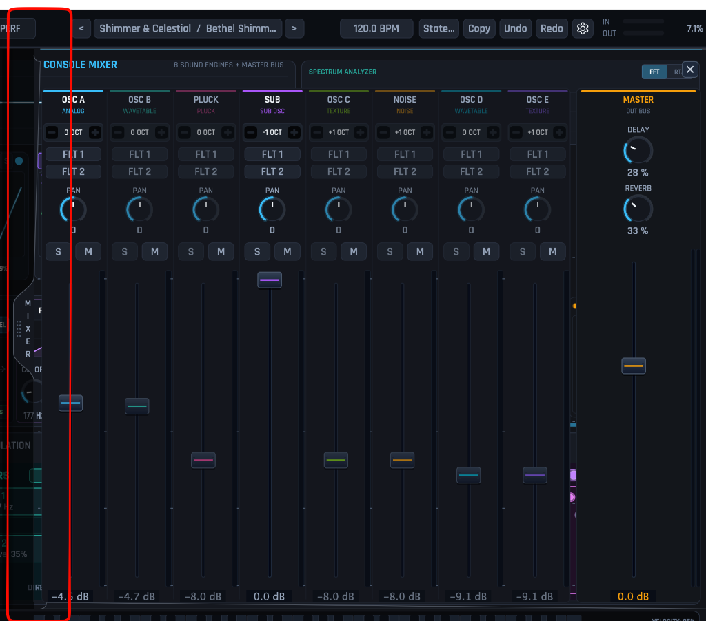

# Nova Synth

<p align="center">
  
</p>

<p align="center">
  <strong>Next-Generation Hybrid Synthesizer & Acoustic Sound Engine for Worship, Ambient, and Cinematic Music Production</strong><br/>
  <em>✨ Proudly 100% Vibe-Coded with Google Antigravity & Advanced Agentic AI</em>
</p>

<p align="center">
  
  
  
  
  
  
  
  
</p>

---

## Overview

**Nova Synth** is a flagship hybrid synthesizer and sound-design instrument built in C++20 and JUCE 8. Engineered specifically for contemporary worship music, modern film scoring, ambient atmospheres, and electronic production, Nova Synth combines multi-engine synthesis (analog, wavetable, granular, physical modeling, sample playback) with studio-grade spatial effects, an intuitive modular workflow, and zero-compromise real-time audio safety.

Whether dialing in a lush Hillsong-style shimmer pad, a punchy analog Moog bass, an intimate felt piano, or a multi-layered cathedral soundscape, Nova Synth delivers immediate inspiration with a sleek, dark cyber-aesthetic UI.

---

## Key Features

### 1. 8 Multi-Engine Sound Sources
Each of the 8 voice slots can independently run any of the following synthesis engines:
* **Warm Analog (PolyBLEP):** Classic Saw, Pulse/PWM, Triangle, Sine, Super-Saw, and Hard Sync with vintage analog voice drift.
* **Evolving Wavetable:** 8-frame wavetable morphing through spectral harmonics, cathedral organ drawbars, velvet strings, and vocal formants with golden-angle phase dispersion and 5-voice stereo unison.
* **Organic Texture / Granular:** Multi-voice stereo unison ensembles including ambient choir breath with Hann formant morphing, bowed cello sections, analog tape flutter with wow/flutter drift, cathedral rain clouds, and warm wind swells.
* **Physical Pluck / Modal Waveguide:** Acoustic steel strings, nylon worship harps, music boxes, and resonant glass mallets powered by Karplus-Strong waveguide synthesis.
* **True-Stereo Multi-Zone Sample Engine:** Pristine acoustic instrument playback with 4-point Hermite cubic interpolation, multi-octave velocity zones, and natural 4.5s acoustic decay:
  * *Steinway Concert Grand Piano* (Forte multi-zone C2 & C4)
  * *Concert Grand Harp* (Multi-zone C3 & C5)
  * *Yamaha Upright Keybed & Felt Thump*
  * *Celesta Soft Mallet Bell*
  * *Orchestral Steel Glockenspiel* (Multi-zone C5 & C6)
  * *Worship Hand Chimes* (Multi-zone C4 & C5)
  * *African Thumb Kalimba*
  * *Sacred Cathedral Flute Pipe Organ*
* **Sub-Bass Oscillator:** Pure Sine, Triangle, Driven 808, and Punchy Square with intelligent **Lowest-Note Priority** voicing to eliminate low-end polyphonic mud.
* **Noise & Attack Transients:** Analog pink noise, velvet vinyl dust, white shimmer air, and key clicks.

<p align="center">
  
</p>

### 2. Slide-Over 8-Channel Hardware Mixer
* A slide-over hardware drawer accessible anytime via the top toolbar or edge handle.
* Features 8 full-strip channel faders calibrated from $+6.0\text{ dB}$ down to $-\infty\text{ dB}$, dual high-refresh LED peak meters, pan knobs, Mute, Solo, and quick-routing toggles between Filter 1, Filter 2, Filter 1+2, or Direct Out.

### 3. Dual Zero-Delay Feedback (ZDF) Filters & Dynamic Headroom
* Two independent multi-mode State Variable Filters (SVF) supporting 12 dB/oct and cascaded 24 dB/oct 4-pole slopes (Low-Pass, High-Pass, Band-Pass, Notch, and Vocal Formant Peak) with resonance gain compensation and series cascade routing.
* Interactive physical Bode frequency-response display with live animated spectrum curve.
* Flexible routing: Series, Parallel, or Split per oscillator.
* Intelligent dynamic polyphonic headroom scaling and zero-DC soft saturation preventing harsh clipping across complex multi-note chord voicings.

### 4. Modulation Hub & Performance Macros
* **Quad ADSR Envelopes:** 4 visual envelope cards with draggable curves, exponential decays, and snap-to-zero release phases.
* **Quad Multi-Shape LFOs:** Synced (1/1 to 1/32T) or free-running (0.01 Hz to 20 Hz) with Sine, Triangle, Saw, Square, Sample & Hold, and Smooth Drift.
* **16-Slot Modulation Matrix:** Direct routing of Envelopes, LFOs, Mod Wheel, Velocity, and Macros to filter cutoff, morph, pitch, pan, and FX.
* **4 Worship Performance Macros:** *Warmth* (tape saturation & low-end bloom), *Motion* (chorus detune & stereo width), *Shimmer* (pitch-shifted upper octave reflections), and *Air* (high-shelf sparkle).

### 5. Built-in FX Suite & Space Reverb
* **Nova Space Reverb:** Dual-engine lush cloud tank with up to 20 seconds of infinite freeze, Valhalla-inspired pitch-locked multi-octave shimmer bloom, decoupled decay-preservation feedback, and adaptive auto-ducking to keep note attacks crisp.
* **Stereo Tape Delay:** Ping-pong delay with straight, dotted 8th, and triplet subdivisions, analog tape wow/flutter, and stereo width swing.

### 6. Cathedral Drone Pad & Polyphonic Arpeggiator
* **Drone Hub:** Dedicated continuous root drone pad with selectable keys (C through B) and harmonic voicings (Octaves, Root + 5th, Power Chord, Sacred Chord).
* **64-Step Arpeggiator:** Up, Down, Up-Down, Random, Chord, and As-Played modes, octave spread (1 to 4), swing, and a 64-step velocity and gate length pattern sequencer.

---

## Factory Preset Library

Nova Synth ships with **43 professionally tuned presets** categorised into:
* **Atmospheric Pads & Shimmers:** *Bethel Shimmer Cloud*, *Angelic Celestial Harp & Choir*, *Ethereal Morning Dawn*, *Cathedral Prayer Drone*, *Warm Juno 106 Pad*, *Cinematic Dark Swell*.
* **Basses & Subs:** *Moog Analog Punch Bass*, *808 Saturated Sub*, *Reese Stereo Motion Bass*, *Acid 303 Resonant Bass*, *Deep Hillsong Worship Sub & Pad*.
* **Plucks & Leads:** *Hillsong 1/8d Pluck Lead*, *Glass Kalimba / Bell*, *Punchy Marimba Mallet*, *Majestic Praise Poly-Lead*, *Vocal Formant Solo Lead*, *Analog Velvet Flute Lead*.
* **Arpeggiators & Pulses:** *Sunday Morning Arp Pulse*, *Celestial 1/8d Halo Arp*, *Music Box & Vinyl Dreams*, *Euphoric Poly-Arp 1/16*.
* **Hybrid & Acoustic Solo Instruments:** *Solo Concert Grand Piano*, *Pure Concert Harp Solo*, *Nordic Celesta & Glockenspiel*, *Nils Felt Piano & Warm Pad*, *Sacred Pipe Flute Swell*, *Cathedral Chime & Choir Ambient*.

---

## Architecture & Real-Time Safety

Nova Synth is engineered under strict audio-thread constraints:
* **Zero Audio Thread Allocations:** No `malloc`, `new`, or standard container reallocations occur in `processBlock`.
* **Lock-Free Communication:** Thread-safe lock-free ring buffers and atomic state machines connect the DSP engine to the GUI.
* **Denormal Protection:** Scoped denormal flags (`juce::FloatVectorOperations::disableDenormalisedNumberSupport`) ensure CPU spikes never occur during reverb decay tails or silence.
* **Realtime Verified:** Passes all 56 unit, integration, and DSP regression tests.

---

## Building from Source

### Prerequisites
* **Operating System:** macOS 13.0 (Ventura) or later (Apple Silicon & Intel supported)
* **Compiler:** Apple Clang 14.0+ / Xcode Command Line Tools (`xcode-select --install`)
* **Build System:** CMake 3.22+ and Ninja (or make)

### 1. Clone the Repository
```bash
git clone https://github.com/realadissu/NovaSynth.git
cd NovaSynth
```

### 2. Configure with CMake
```bash
cmake -B build -DCMAKE_BUILD_TYPE=Release
```

### 3. Build Plugins and Standalone
```bash
# Build Standalone, Audio Unit (AU), VST3, and CLAP
cmake --build build --target NovaSynth_Standalone NovaSynth_AU NovaSynth_VST3 NovaSynth_CLAP -j8
```

The compiled binaries will be generated under:
* **Standalone App:** `build/plugins/nova_synth/NovaSynth_artefacts/Release/Standalone/Nova Synth.app`
* **Audio Unit (AUv2):** `build/plugins/nova_synth/NovaSynth_artefacts/Release/AU/Nova Synth.component`
* **VST3 Plugin:** `build/plugins/nova_synth/NovaSynth_artefacts/Release/VST3/Nova Synth.vst3`
* **CLAP Plugin:** `build/plugins/nova_synth/NovaSynth_artefacts/Release/CLAP/Nova Synth.clap`

### 4. Install into macOS System Plug-in Folders
```bash
# Install AU component
cp -R "build/plugins/nova_synth/NovaSynth_artefacts/Release/AU/Nova Synth.component" ~/Library/Audio/Plug-Ins/Components/

# Install VST3 plugin
cp -R "build/plugins/nova_synth/NovaSynth_artefacts/Release/VST3/Nova Synth.vst3" ~/Library/Audio/Plug-Ins/VST3/

# Install CLAP plugin
cp -R "build/plugins/nova_synth/NovaSynth_artefacts/Release/CLAP/Nova Synth.clap" ~/Library/Audio/Plug-Ins/CLAP/
```

### 5. Run the Automated Test Suite
```bash
cmake --build build --target NovaPluginsTests -j8
ctest --test-dir build --output-on-failure
```

### 6. Validate with Apple `auval`
```bash
auval -v aumu NvSy NovA
```
*(Should output `AU VALIDATION SUCCEEDED` with zero failures).*

---

## 💜 100% Vibe Coded with Google Antigravity

**Nova Synth is proudly and entirely vibe-coded.**

The entire instrument — from its real-time C++20 DSP audio core, SIMD algorithms, and lock-free state synchronization to its dark cyber-glass UI, preset architecture, and 56 passing regression tests — was created through iterative AI pair programming between **Wolfgang Meincke** and **Google DeepMind's Antigravity** agentic AI.

It serves as a real-world proof of concept that complex, professional-grade audio DSP and native audio plugins (AU, VST3, CLAP, and Standalone) with zero-compromise real-time safety can be designed, implemented, and refined through pure vibe coding and collaborative human-AI listening feedback loops.

---

## 💬 Community, Feedback & Issues

Have feedback, found a bug, or want to request a new synthesis model or worship preset?
* **File an Issue:** We welcome bug reports and feature suggestions directly via [GitHub Issues](https://github.com/realadissu/NovaSynth/issues).
* **Presets & Sound Design:** Suggestions for new pad profiles, sample soundscapes, and modulation routings are always welcome!

---

## Licensing & Third-Party Credits

* **Core DSP & Plugin Code:** [MIT License](LICENSE) (or JUCE commercial license depending on deployment).
* **Audio Samples:** 100% royalty-free under **Creative Commons Zero 1.0 Universal (CC0 1.0)** / **Public Domain**. Sourced and mastered from the Versilian Community Sample Library (VCSL by Sam Gossner) and MIS. For full per-sample details, see [`LICENSES_AUDIO.md`](LICENSES_AUDIO.md).
* **UI Typography:** Rajdhani font family by Indian Type Foundry under the **SIL Open Font License 1.1** (OFL).
* **Third-Party Libraries:** JUCE 8 (PACE / Raw Material Software), `clap-juce-extensions`, GoogleTest. Full legal notices are provided in [`LEGAL.md`](LEGAL.md).

---

## Author & Contact

* **Repository:** [https://github.com/realadissu/NovaSynth.git](https://github.com/realadissu/NovaSynth.git)
* **Author / Maintainer:** Wolfgang Meincke ([realadissu](https://github.com/realadissu))
